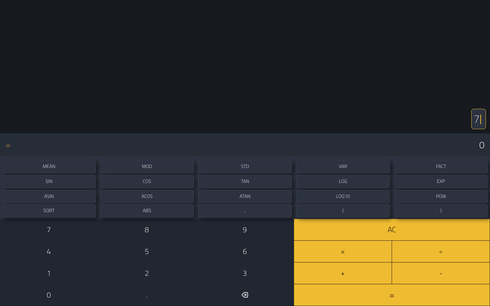
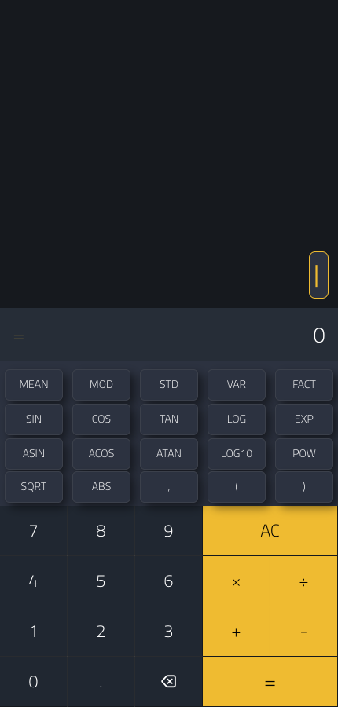

# MauiScientificCalculator, running in the browser with MauiWeb

[naweed/MauiScientificCalculator](https://github.com/naweed/MauiScientificCalculator) is a .NET MAUI scientific
calculator by Naweed Akram (MIT). This repository is the same app, moved to **.NET 11 / .NET MAUI 11.0.0**, with
one extra project that serves it as a website through [MauiWeb](https://mauiweb.appmare.com). The XAML, the
view model and the NCalc evaluation are untouched: the browser gets real HTML rendered on the server, and every
key press runs the app's own C#.

| Desktop | After pressing 7 | Phone width |
| --- | --- | --- |
|  |  |  |

## Run it

Requirements: the .NET 11 SDK and the .NET MAUI 11 workload (`dotnet workload install maui`).

```bash
dotnet run --project src/MauiScientificCalculator.Web
```

Open <http://localhost:5322>. MauiWeb is free on localhost, `.local`, `.test` and private hosts; a public
domain needs a licence (see the [pricing](https://mauiweb.appmare.com)).

The phone heads are still there: `src/MauiScientificCalculator` targets `net11.0-android`, `net11.0-ios`,
`net11.0-maccatalyst` (and Windows on Windows) as before.

## What changed from the original

1. **`src/MauiScientificCalculator/MauiScientificCalculator.csproj`** — targets moved from `net6.0-*` to
   `net11.0-*`, a plain `net11.0` target added (built as a library, so the web host can reference it),
   `CommunityToolkit.Mvvm` 8.0.0-preview4 → 8.4.0, `Microsoft.Maui.Controls` 11.0.0 referenced explicitly.
2. **`src/MauiScientificCalculator/MauiProgram.cs`** — `CreateMauiApp` takes an optional
   `Action<MauiAppBuilder>` so a host can add its own setup. The phone heads call it with no argument.
3. **`src/MauiScientificCalculator.Web/`** (new) — an empty ASP.NET Core project with the `AppMare.MauiWeb`
   package and one line in `Program.cs`:

   ```csharp
   app.MapMauiWeb(() => MauiProgram.CreateMauiApp(b => b.UseMauiWeb()));
   ```

   plus an item group that copies the app's `Resources/` (fonts, images) next to the web host.

Nothing in `Views/` or `ViewModels/` was edited.

## Licence

The app is MIT, © 2022 Naweed Akram (see [LICENSE](LICENSE)). The web host project added here is MIT too.
MauiWeb itself is a commercial package by [AppMare](https://appmare.com), free for local development.
